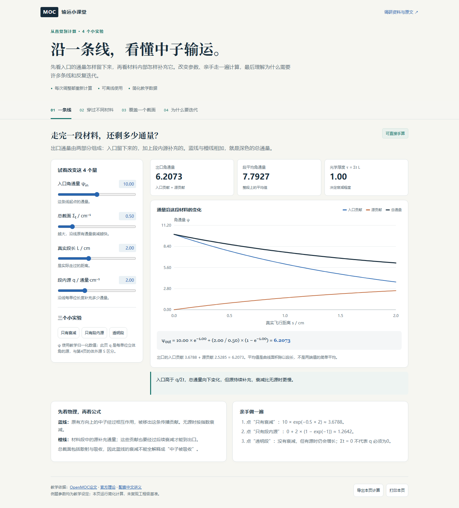

# MOC 交互小课堂

打开[单文件演示](index.html)。在本地仓库双击 `index.html` 即可用浏览器学习；若从GitHub使用，先下载HTML文件再打开。页面没有外部脚本、字体或网络计算依赖，断网也可以操作。

按顺序体验四页：

1. **一条线：** 改入口、总截面、长度和源，观察两项贡献与总角通量，查看代入公式。
2. **不同材料：** 三段接力，逐段查看出口如何成为下一段入口；改变斜射角和材料参数。
3. **二维覆盖：** 实际计算圆形燃料交点、轨迹段长与面积近似；比较加密轨迹、转动方向和缩小区域。
4. **源迭代：** 一格手算与20格空间分布；执行单群两方向固定源计算，观察相邻轮变化、吸收与泄漏。

页脚可导出当前页的CSV计算结果，也可打印当前教学页。切换第4页的参数会清空上一组迭代，以免混合不同模型的结果。

配合[中文教学讲义](../docs/03-moc-tutorial.md)阅读。全体参数均为教学设定，前三页的角通量与第四页的标量通量有不同定义，源归一化也分别说明。第三页只展示一个方向的几何积分；第四页仅是一维平板、单群、两个方向、真空边界、无裂变的教学模型。

数值与界面验证见[测试记录](../tests/README.md)，默认例题数值见[结果文件](../examples/teaching-results.json)。此版本尚未复现C5G7、BEAVRS或工程级二维/三维MOC。

