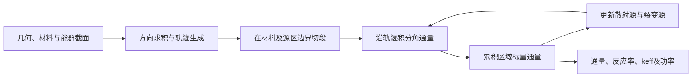

# MOC 中子输运调研：从直觉到研究问题

更新：2026-10-10。本文是第一版学习型调研，针对尚未学习特征线法的读者。先读第 1–5 节，再进入三维、加速和研究问题。文献编号对应[文献目录](../references/literature.md)，具体阅读依据见[结构化目录](../references/catalog.json)。本文没有开展求解器复现或新的数值实验。

## 1. MOC 是什么，为什么需要它？

MOC 是 Method of Characteristics，中文通常称**特征线法**。这里讨论的是用于求解中子输运方程的数值方法：选定一批中子运动方向，在几何中生成直线轨迹，把沿这些轨迹的输运方程积分，再把各条线、各个方向的贡献合成为区域中子通量。

反应堆中的中子有位置、能量和运动方向。它们会飞行、散射、被吸收，也会诱发裂变。若只求一个不含方向的平均量，就可能难以描述燃料与慢化剂交界处、强吸收体附近、空腔或局部功率分布。输运计算保留方向信息，MOC 是完成这种计算的一条路线。[P02](../references/literature.md#p02)、[R01](https://mit-crpg.github.io/OpenMOC/methods/index.html)

它常用于燃料栅元、组件以及进一步的三维全堆计算。典型输出包括有效增殖因子 $k_{\mathrm{eff}}$、分区分群通量和反应率；通过裂变反应率及能量释放数据，还可得到归一化功率分布。截面制备、耗尽、热工反馈等需要额外模型，不能由“采用 MOC”自动获得。[P02](../references/literature.md#p02)、[P07](../references/literature.md#p07)

一个直观例子：一条轨迹依次穿过慢化剂、燃料、包壳和慢化剂。对每个材料段计算“入口通量经过衰减，再加上段内源的贡献”，段出口接着成为下一段入口。许多这样的线覆盖整个区域，许多方向共同构成通量的角度积分。

## 2. 它与扩散、其他输运方法、蒙特卡罗有什么关系？

| 方法 | 核心处理方式 | 学习时应关注的差别 |
|---|---|---|
| 扩散方法 | 对输运方程作角度矩与闭合近似，求标量通量 | 成本通常较低，但强方向性和局部非均匀性可能挑战近似 |
| 常见 $S_N$ 网格输运 | 角度离散为有限方向，在空间网格上求解每个方向的方程 | 与常规 MOC 都要做方向求积；空间离散和扫描组织方式不同 |
| 常规 MOC | 沿确定性轨迹积分，结合方向求积和空间源表示 | 指数段解、轨迹覆盖、空间源近似与边界连接是重点 |
| 常规粒子历史蒙特卡罗 | 抽样飞行距离、碰撞和粒子反应历史，统计目标量 | 存在统计不确定度；局部低概率量可能需要大量历史或减方差 |
| Random Ray | 随机抽样特征轨迹，再沿线求解输运方程 | 是特征线相关的随机积分方法，需检查采样误差和源迭代 |

表中是算法层面的比较，不能据此排列所有问题上的精度或速度。MOC 的常规确定性形式没有粒子统计涨落，但仍有能群、空间、角度和轨迹离散误差；蒙特卡罗也受到核数据、建模、统计收敛等限制。比较必须先统一几何、材料、能量处理和评价量。[P01](../references/literature.md#p01)、[P02](../references/literature.md#p02)、[P13](../references/literature.md#p13)

“MOC”与“混合 Monte Carlo/Deterministic”也不是同义词。前者是一种输运求解方法；后者描述确定性计算与蒙特卡罗计算之间的耦合，例如用确定性重要性信息指导蒙特卡罗抽样。当前仓库聚焦 MOC，仅把随机射线作为相邻扩展介绍。

## 3. 先认识五个量

| 符号 | 含义 | 如何理解 |
|---|---|---|
| $\psi_g(\mathbf r,\Omega)$ | 第 $g$ 群角通量 | 某个位置、某个方向的中子通量 |
| $\phi_g(\mathbf r)=\int_{4\pi}\psi_g\,d\Omega$ | 标量通量 | 把所有方向的角通量积分起来 |
| $\Sigma_{t,g}$ | 宏观总截面 | 单位路径长度上的总相互作用强度，常用单位 $\mathrm{cm}^{-1}$ |
| $q_g$ | 每单位立体角的源 | 散射、裂变以及外源对该方向的供给 |
| $k_{\mathrm{eff}}$ | 有效增殖因子 | 临界特征值问题中调节裂变源强度的特征值 |

这里采用完整立体角积分，方向求积权重之和为 $4\pi$。某些程序使用权重和为 1 的约定，并把 $4\pi$ 移入通量定义或累积公式。两种约定都可以，但不能混用。详见[术语表](glossary.md)。

对稳态、多群、各向同性散射与裂变源，区域 $i$ 中可写为

$$
\Omega\cdot\nabla\psi_g+\Sigma_{t,g}\psi_g=q_g,
$$

$$
q_{i,g}=\frac{1}{4\pi}\left[
\sum_{g'}\Sigma_{s,i,g'\to g}\phi_{i,g'}
+\frac{\chi_{i,g}}{k_{\mathrm{eff}}}\sum_{g'}\nu\Sigma_{f,i,g'}\phi_{i,g'}
+S^{\mathrm{ext}}_{i,g}\right].
$$

$S^{\mathrm{ext}}$ 在此是对立体角积分后的各向同性体外源。临界特征值问题通常不含外源；非增殖固定源问题可去掉裂变项。各向异性散射需要角度矩等额外表示，不能继续仅用上述标量通量表达全部散射源。这些是本文入门推导的假设，不是 MOC 必须采用的全部限制。[P02](../references/literature.md#p02)、[R03](../papers/pdf/R03_MPACT_2023_Theory_Manual_4.4.pdf)

## 4. 最关键的一步：把空间偏微分方程变成沿线常微分方程

选定方向 $\Omega$，用真实飞行距离 $s$ 参数化直线：

$$
\mathbf r(s)=\mathbf r_0+s\Omega.
$$

链式法则给出 $d\psi/ds=\Omega\cdot\nabla\psi$，因此有

$$
\frac{d\psi_g}{ds}+\Sigma_{t,g}\psi_g=q_g.
$$

物理图像：每走一小段距离，一部分原有角通量被相互作用移走，同时源补充新的角通量。特征线变换本身并没有消除源与其他方向、能群的耦合；耦合仍由源更新处理。

### 4.1 平源段的解析解

若一个长度为 $L$ 的段内 $\Sigma_t$ 和 $q$ 均为常数，令 $\tau=\Sigma_tL$，则

$$
\boxed{\psi_{\mathrm{out}}=\psi_{\mathrm{in}}e^{-\tau}
+\frac{q}{\Sigma_t}(1-e^{-\tau})}.
$$

右侧第一项是入口角通量的衰减；第二项是段内源产生且存活到出口的贡献。段平均角通量为

$$
\boxed{\bar\psi=\frac{q}{\Sigma_t}
+\left(\psi_{\mathrm{in}}-\frac{q}{\Sigma_t}\right)
\frac{1-e^{-\tau}}{\tau}}.
$$

例如取 $\Sigma_t=1\,\mathrm{cm}^{-1}$、$L=1\,\mathrm{cm}$、入口通量为 0、数值源 $q=2$（采用一致单位），出口为 $2(1-e^{-1})\approx1.2642$，段平均为 $2e^{-1}\approx0.7358$。这个例子直接来自公式，是教学计算，未涉及真实反应堆数据。

当 $\Sigma_t=0$ 时直接积分得到 $\psi_{\mathrm{out}}=\psi_{\mathrm{in}}+qL$、$\bar\psi=\psi_{\mathrm{in}}+qL/2$。薄段计算还需避免 $1-e^{-\tau}$ 的相消误差，可使用 `expm1` 与小光学厚度展开。可见[算法与验证](02-algorithm-and-validation.md)中的稳定形式。

### 4.2 为什么还需要空间离散？

平源区 FSR（Flat Source Region）意味着**源在区域内按常数表示**。沿线角通量仍按上述指数形式变化。材料均匀的燃料棒仍可能需要分成多个源区，因为中子源与通量随半径、方位变化。把整个组件材料均匀化，与保留材料结构但采用平源区，是两种不同近似。[P02](../references/literature.md#p02)

“段积分解析”只表示在给定段源和截面的条件下，这个常微分方程被解析积分。它并不意味着完整输运问题没有离散误差。

### 4.3 二维轨迹长度与实际飞行距离

二维横截面计算仍会对极角和方位角积分。若 $\theta$ 是相对于 $z$ 轴的极角，轨迹在 $xy$ 平面的投影长度为 $\ell_{xy}$，则真实飞行距离为

$$
L=\frac{\ell_{xy}}{\sin\theta},\qquad
\tau=\Sigma_t\frac{\ell_{xy}}{\sin\theta}.
$$

相同投影段在较小 $\sin\theta$ 下对应更长飞行距离，衰减更强。二维面积累积仍使用投影的几何面积权重，不能把真实距离无条件代入投影面积公式。轴向方向 $\sin\theta=0$ 需要专门处理或由所选求积规则避开，不能直接除零。[P02](../references/literature.md#p02)

## 5. 一个 MOC 计算如何完成？

1. **给定模型。** 定义几何、材料、能群截面、源区及真空/反射/周期等边界。
2. **生成方向和轨迹。** 选定角度求积与轨迹间距，对每条轨迹找出穿过各区的顺序和段长。
3. **初始化通量和源。** 由当前通量估计散射源及裂变源。
4. **执行输运扫描。** 从轨迹入口沿各段计算出口角通量与段积分，并处理边界连接。
5. **累积标量通量。** 用方向权重及轨迹代表的空间权重，合成区域平均通量。
6. **更新并迭代。** 更新源；特征值问题还更新 $k$ 与归一化。达到源、通量、特征值及必要平衡准则后输出结果。

轨迹不能只是一组画在几何上的细线：每条轨迹必须代表一定空间份额。对每个方向，轨迹段的体积/面积累积应与真实源区体积/面积相符；否则通量归一化会受轨迹覆盖影响。反射边界要把离开边界的方向映射到对应入射方向；周期边界还要匹配两侧的位置和方向。只复制一个标量通量不能表达这些条件。[P02](../references/literature.md#p02)、[R03](../papers/pdf/R03_MPACT_2023_Theory_Manual_4.4.pdf)

为什么迭代？散射源包含通量，而通量又取决于源。强散射时，一次扫描往往只能消除部分误差；在增殖问题中，裂变源的空间形状也要逐步收敛。仅观察 $k$ 基本不再变化，不能保证局部功率已经收敛。

## 6. 精度到底由什么决定？

| 误差来源 | 可调设置或待查因素 | 建议检查 |
|---|---|---|
| 核数据与多群处理 | 数据库、温度、共振处理、群结构与凝聚谱 | 统一截面来源；区分截面误差和空间算法误差 |
| 空间源近似 | 平源/线性源、源区尺寸与划分 | 在固定角度和轨迹设置下细化源区 |
| 角度求积 | 方位角、极角及散射展开 | 在固定空间设置下增加方向；关注射线效应 |
| 轨迹空间积分 | 轨迹间距、覆盖与体积修正 | 加密轨迹，检查小区域与边界附近的覆盖 |
| 几何与边界实现 | 交点、段长、重复单元接口 | 检查段顺序、长度和边界映射 |
| 迭代残差 | 散射源、裂变源、通量及 $k$ 容差 | 收紧容差后结果应保持稳定 |

这些因素会相互影响。角度方向少时，把轨迹加得很密也不能消除所有角度误差；源区过粗时，把迭代容差收得很紧也不能消除源近似误差。常规 MOC 使用离散方向，因此仍可能出现方向不足造成的射线效应。

验证不能只报 $k_{\mathrm{eff}}$。建议同时报告分区/棒功率、通量或反应率的局部误差、全局中子平衡，以及参考解的不确定度。[验证路线](02-algorithm-and-validation.md)将这些检查分成入门算例和公开基准。

## 7. 从平源到线性源：怎样减少空间近似误差？

平源法通过增加源区分辨率来表示空间变化。另一条路线是在区内保留源的梯度，例如

$$
q_g(\mathbf r)\approx q_{0,g}+\mathbf a_g\cdot(\mathbf r-\mathbf r_c).
$$

沿某条段投影后，这是关于距离 $s$ 的线性函数，仍可对特征方程作解析积分。但更新源梯度需要通量空间矩、几何矩及相应累积，不能仅把常数源替换为任意斜率。[P04](../references/literature.md#p04)

读 P04 时建议关注：线性源的系数如何求出；区域几何如何进入矩；额外存储和累积成本是多少；在**相同目标误差**下是否能减少源区数。较高空间阶数不自动保证在所有硬件或复杂几何上更快。

## 8. CMFD：为什么扫描已经很快，整体仍可能很慢？

一次扫描成本与扫描次数共同决定总成本。CMFD（Coarse Mesh Finite Difference，粗网有限差分）主要改善源迭代的收敛：从细尺度输运结果得到粗网通量、截面和界面净流等信息，构造并求解粗网方程，再用粗网解修正细网通量或源。[P10](../references/literature.md#p10)、[R03](../papers/pdf/R03_MPACT_2023_Theory_Manual_4.4.pdf)

其有效性依赖输运结果与粗网方程之间的一致性修正。这里的粗网方程承担加速作用；最终细尺度输运解仍需满足原求解问题。不能把任意扩散求解器接在扫描后，就认为获得了稳定、正确的 CMFD。

需要区分三个问题：MOC 如何减少单次扫描耗时；CMFD 如何减少迭代次数；CMFD 自己的线性方程如何高效求解。P10 同时涉及 GPU 和两级 CMFD，其加速倍数依赖算例、硬件、比较基线和算法组合，不能解释为单独迁移到 GPU 的普遍收益。较少线性迭代也未必对应较短耗时。

## 9. 为什么三维特别困难？有哪些路线？

三维不仅增加一个坐标，还会增加轨迹数、切段数、角通量边界数据、通信和存储需求。研究常围绕“保留哪些物理和空间近似，如何控制这些资源”展开。

| 路线 | 核心想法 | 对应资料 | 读时要核对 |
|---|---|---|---|
| 直接三维 MOC | 沿三维方向在完整几何内积分 | P05、P07 | 轨迹、空间源和角度离散，以及内存代价 |
| 模块化追踪 | 复用典型重复单元的轨迹结构 | P05 | 单元接口如何匹配；适合什么重复几何 |
| 即时追踪 | 扫描时生成部分切段，降低预存数据量 | P07、P11 | 少存了什么；多做了多少几何计算；几何是否轴向挤出 |
| 非结构网格三维 MOC | 支持较复杂三维空间离散 | P08 | 射线求交、切段和通信代价；空间近似的具体形式 |
| 2D/1D | 径向二维 MOC 与轴向一维模型耦合 | P06、R03 | 横向泄漏、轴向近似、耦合稳定性和适用条件 |
| 特征面方法 | 使用特征面及轴向展开处理三维问题 | P15 | 它改变了离散对象，应单独比较其推导和假设 |

2D/1D 不是简单把若干二维切片各自求完。径向与轴向通过泄漏等量交换信息；轴向求解器及耦合方式决定精度和稳定性。P06 适合用来了解这种权衡，R03 提供更系统的具体理论。

P05、P07、P08、P11、P15 的初步定位依据为摘要或官方正文片段，并非全部公式与算例精读。表中“要核对”是后续阅读任务，不能当作这些实现已经统一达到的能力。

## 10. 并行、向量化与 GPU：读性能文章时看什么？

MOC 的不同轨迹、能群、角度和源区为并行提供机会，但入口边界依赖、区域分解、通量累积和负载差异也会限制效率。P09 讨论任务组织和向量化，采用优化的代理程序研究计算内核；代理程序的表现不能直接视为完整堆芯应用的端到端表现。

GPU 路线还受到显存容量、数据传输、浮点精度、累积冲突和轨迹负载不均的影响。P11 是较新的少群三维案例，可在读懂基础算法后观察空间源、即时追踪、分批计算如何组合；该文目前仅做摘要级定位，速度数据尚未逐项复核。

对任意性能结论，建议记录以下项目：

- 问题规模：源区数、群数、方向数、轨迹与切段数。
- 精度：相同空间/角度设置，或更有意义的相同目标误差。
- 成本：预处理、扫描、加速层、通信和总耗时；峰值内存/显存。
- 基线：硬件、线程数、编译选项、是否都使用相同加速。
- 扩展：强扩展固定问题规模；弱扩展随资源增加问题规模。

## 11. 随机射线与重要性抽样：相邻方向如何衔接？

P13 的 Random Ray 将特征轨迹的相空间积分改为随机抽样，仍沿射线积分输运方程。研究价值在于探索轨迹存储和空间覆盖的另一种组织方式，同时需要评估统计误差、射线参数、源迭代和可能的偏差。[P13](../references/literature.md#p13)

本仓库保存的是 MIT 标为作者最终稿的版本，封面关联 2017 年正式 DOI，但正文页脚标注 2018-09-20；请使用[版本说明](../papers/README.md)区分仓库稿与正式排版版。

P14 RASTr 进一步讨论重要性抽样：改变射线的空间和角度抽样分布，并通过权重补偿构造估计量。它适合在 P13 之后阅读，重点是“把更多计算资源放在哪里”与“估计量是否仍正确”。本次归纳基于作者预印本与[正式出版社摘要](https://www.sciencedirect.com/science/article/abs/pii/S030645492600040X)，正式 2026 年版书目已核验，正文尚未精读。

如果以后继续研究混合蒙特卡罗/确定性方法，需要单独梳理伴随重要性、权窗、减方差和确定性辅助计算；当前两篇随机射线论文提供了相关概念，但不能代替那一方向的完整调研。

## 12. 初学者怎么用这些资料？

**第一步：能解释一条线。** 阅读 R01 的特征线变换和平源积分，以及 P02 的方法部分。独立推导入口到出口和段平均的两个公式，算一个无源吸收例子、一个有源例子。

**第二步：能解释整个循环。** 画出几何切段、扫描、通量累积、源更新和边界映射，列出空间、角度、轨迹、迭代四类误差。用 P02 对照公式与程序对象；安装运行属于后续实践，本仓库尚未测试 OpenMOC 的本机安装。

**第三步：知道改进改了哪一层。** P04 处理空间源表示；P10 处理迭代与硬件；P05/P06 处理三维路线；P09 处理计算内核。给每篇标明其作用环节，再比较结果。

**第四步：选择一个可验证的问题。** 例如同一二维基准下轨迹间距与角度的误差分解，或相同精度下平源与线性源的成本比较。完整建议见[研究问题与记录模板](research-questions.md)。

对于首次调研，推荐核心顺序：**R01 → P02 → P01 的中子输运部分 → P04 → R01 的 CMFD / P10 → P05 → P06**。P03 可作教材式补充，三维工程与性能、随机射线、近期论文按方向分支阅读。每篇的具体任务在[阅读路线](reading-plan.md)中。

## 13. 本轮调研得到的判断与边界

1. MOC 的基本单元易于推导；完整程序的难点集中在空间/角度积分、源迭代、边界连接和几何追踪。
2. “更高空间阶数”“更少迭代”“更快扫描”“更少轨迹存储”解决的是不同成本或误差，应分别识别再组合比较。
3. 三维路线需同时交代物理近似与资源代价。直接三维、2D/1D、特征面不能仅用名字或一次运行时间判断优劣。
4. 现有资料足以搭建入门框架和首轮阅读清单；证明某项改进的普适优势或新颖性，仍需精读全文、扩大检索并做统一验证。

前面公式为明确假设下的数学推导；具体论文定位以 catalog 中的 `reading_basis` 为准。保存全文表示已获得并校验文件，不表示已经逐式复核全文。此仓库没有声称完成全面系统综述、代码复现或新的性能测量。

继续阅读：[算法与验证](02-algorithm-and-validation.md) · [逐篇文献说明](../references/literature.md) · [原文及许可](../papers/README.md)
