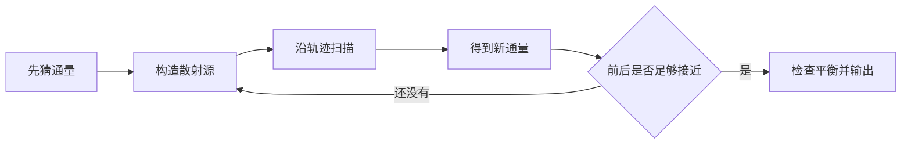

# MOC 教学调研：用四个小实验理解特征线法

整理：2026-10-10。面向第一次接触MOC的读者。建议边读边打开[交互小课堂](../demo/index.html)：将该HTML文件下载后用浏览器打开，或在本地仓库中双击它；GitHub文件页面只显示源码。

这份材料先说明“算什么”，再手算“沿一条线怎么算”，然后解释“整个区域怎么合起来”和“为什么要重复”。最后再把这些问题对应到已有论文。参数都是教学设定，不是实际堆芯材料数据；演示中的平板模型只有单群、两个方向和真空边界。

## 1. 先理解它想解决的问题

假设你想知道：一个燃料组件里，中子通量在哪里高、在哪里低？有多少中子在燃料中引发裂变？局部功率分布怎样？这些问题不能只靠“数一数中子总量”回答，还需要知道中子在什么位置、朝哪里运动、具有怎样的能量。

中子在飞行时可能被吸收，也可能散射到别的方向或能量，还可能诱发裂变产生新中子。**输运方程就是这些运动、损失和供给之间的平衡。MOC是求解这个方程的一种数值办法。**

MOC全称Method of Characteristics，中文特征线法。它把复杂几何中的传播问题拆成很多条沿指定方向的直线：每条线在遇到材料或源区边界时分段，每段有明确的入口和出口。

你先不用把所有角度、能群和迭代同时装进脑子。第一轮只记住：

> 一段一段传播，一条一条累积，一轮一轮更新。

工程计算通常关心有效增殖因子、通量、反应率和功率分布。当前小课堂先学传播和散射；裂变特征值、多群截面与热工反馈留到后面。[OpenMOC论文P02](https://doi.org/10.1016/j.anucene.2013.12.012)是把这一框架连接到真实程序的主要参考。

## 2. 先分清“朝一个方向”与“所有方向合起来”

**角通量 $\psi$：** 某个位置、某个方向上的中子通量。可以先把它理解成“朝这个方向的流动强度”，但它不是单个中子的轨迹或中子总数。

**标量通量 $\phi$：** 把所有方向的角通量积分起来。它适合用来计算各类反应率。例如区域平均吸收率与宏观吸收截面和标量通量的乘积有关。

小课堂前两页追踪一条线，显示角通量 $\psi$；第四页合成正反两个方向，显示标量通量 $\phi$。它们的数值不能直接当作同一个物理量比较。

完整问题还需要能群：把连续中子能量划分为若干组。这样每个源区、每个能群都需要相应的通量、截面和源。初学时先用单群，避免同时增加太多符号。

## 3. 为什么沿一条线会容易算？

对某一方向，输运方程可以概括为

$$
\underbrace{\Omega\cdot\nabla\psi}_{\text{沿方向的空间变化}}
+\underbrace{\Sigma_t\psi}_{\text{从当前传播贡献中移出}}
=\underbrace{q}_{\text{向当前方向补充}}.
$$

总截面 $\Sigma_t$ 单位通常为 $\mathrm{cm}^{-1}$。它包含吸收和散射，因此“从当前方向移出”不意味着全部被吸收；散射的中子可能在源项里贡献给其他方向。

沿选定直线，用真实飞行距离 $s$ 描述位置，空间变化就变成沿线变化：

$$
\frac{d\psi}{ds}+\Sigma_t\psi=q.
$$

这相当于问：每向前走一点，原有通量少了多少，段内源又补了多少？如果一个段内截面和源都按常数处理，就可以直接积分，不必把段再切成非常多步去近似指数。

得到最重要的公式：

$$
\boxed{\psi_{out}=\underbrace{\psi_{in}e^{-\Sigma_tL}}_{\text{入口留下的}}
+\underbrace{\frac{q}{\Sigma_t}(1-e^{-\Sigma_tL})}_{\text{源补充的}}}.
$$

$L$是实际走过的长度；$q$在这里是每单位立体角的源。仅在 $\Sigma_t>0$ 时直接使用这个带除法的形式；总截面为0时用它的连续极限。下面的例题帮助你认识这两项，而不是要求先背下所有公式。

## 4. 实验一：没有段内源，入口还能留下多少？

在小课堂第1页点“只有衰减”。设

| 量 | 数值 | 解释 |
|---|---|---|
| 入口角通量 $\psi_{in}$ | 10 | 从起点进入的归一化通量 |
| 总截面 $\Sigma_t$ | $0.5\,\mathrm{cm}^{-1}$ | 沿单位距离的移出强度 |
| 真实段长 $L$ | $2\,\mathrm{cm}$ | 实际传播距离 |
| 段内源 $q$ | 0 | 暂时不补充通量 |

先算光学厚度：

$$\tau=\Sigma_tL=0.5\times2=1.$$

再算入口留下的比例：

$$e^{-1}\approx0.367879.$$

所以

$$\psi_{out}=10\times0.367879\approx\boxed{3.6788}.$$

图上蓝线从10降到3.6788，橙线为0。这里说的是这条传播贡献的衰减；如果相互作用中包含散射，被移出的中子不一定消失。

**试一试：** 总截面保持0.5，把长度改为4。光学厚度变成2，出口应为 $10e^{-2}\approx1.3534$。再把长度恢复为2，总截面改为1，结果相同。这个例子说明：对无源、常数截面的单段，入口留下的比例由乘积 $\Sigma_tL$ 决定。

## 5. 实验二：入口为0，段内源能产生什么？

在第1页点“只有段内源”。取 $\psi_{in}=0$、$\Sigma_t=1$、$L=1$、$q=2$，使用一致的教学单位。

入口没有贡献，出口完全来自段内源：

$$
\psi_{out}=\frac{2}{1}(1-e^{-1})
=2\times0.632121\approx\boxed{1.2642}.
$$

为什么不是 $qL=2$？因为段内较早产生的传播贡献，还要经过后续材料的衰减才能抵达出口。只有没有移出作用的透明段，才有 $\psi_{out}=\psi_{in}+qL$。

### 段平均与出口是两个不同的值

后面要把整段对一个区域的贡献累积起来，需要段平均，而不只是出口值。段平均就是曲线在这一段的积分除以段长：

$$
\bar\psi=\frac{q}{\Sigma_t}
+\left(\psi_{in}-\frac{q}{\Sigma_t}\right)
\frac{1-e^{-\Sigma_tL}}{\Sigma_tL}.
$$

代入本例：

$$\bar\psi=2-2(1-e^{-1})=2e^{-1}\approx\boxed{0.7358}.$$

出口1.2642、段平均0.7358并不矛盾：前者是终点的值，后者把整条曲线平均。指数曲线的平均也不是简单的两端相加再除以2。

**试一试：** 点“透明段”，看到 $\Sigma_t=0$、入口3、源2、长度2。出口为 $3+2\times2=7$，平均为 $3+2\times2/2=5$。界面在这个极限不会除以0。

## 6. 实验三：穿过慢化剂、燃料、慢化剂

打开第2页，恢复默认例题。这里的材料名字用于说明几何分段，截面和源仅为教学数值。

| 段 | 实际长度/cm | $\Sigma_t$/cm⁻¹ | $q$ | 入口 $\psi$ | 出口 $\psi$ | 段平均 $\psi$ |
|---|---:|---:|---:|---:|---:|---:|
| 慢化剂A | 1 | 0.2 | 0 | 10.0000 | 8.1873 | 9.0635 |
| 燃料 | 1 | 1 | 2 | 8.1873 | 4.2762 | 5.9111 |
| 慢化剂B | 1 | 0.2 | 0 | 4.2762 | 3.5010 | 3.8757 |

第一段只有衰减：

$$\psi_1=10e^{-0.2}\approx8.1873.$$

第二段使用第一段的出口作入口，同时有段内源：

$$
\psi_2=8.1873075e^{-1}+2(1-e^{-1})
\approx3.0119421+1.2642411=4.2761832.
$$

第三段再接过去：

$$\psi_3=4.2761832e^{-0.2}\approx\boxed{3.5010}.$$

**这就是扫描的基本动作。** 没有更换另一套公式，只是段长、截面、源与入口不断更新。在完整几何里，要先找到轨迹在哪些位置遇到材料和源区边界。

### 斜着走，为什么结果会变？

例题默认垂直穿层。设 $\alpha$ 是轨迹与层法线的夹角，实际段长为

$$L=\frac{\text{层厚}}{\cos\alpha}.$$

把 $\alpha$ 调到60°，每个1cm厚的层内实际走2cm。于是源贡献和衰减都改变。界面横轴仍是层法线方向的深度，不能把它无条件当作真实距离。

注意本页 $\alpha$ 的定义是与层法线的夹角；二维MOC文献还常用相对于轴向 $z$ 的极角 $\theta$，对应投影关系 $L=\ell_{xy}/\sin\theta$。读论文先确认角度定义，不要只看一个正弦或余弦就代入。

## 7. 从一条线到一个区域，还缺什么？

假如你只从一根燃料棒的中心画一条线，即使它的段积分完全正确，也不知道边缘位置的通量是什么。若只从一个方向看，还不知道其他方向怎样传播。

完整MOC因此需要两类离散：

- **空间覆盖：** 同一个方向放置多条轨迹，使区域被采样覆盖。
- **方向求积：** 选择多个方位和极角，把各方向贡献按权重合成。

在第3页，我们先把方向固定，理解空间覆盖。一个2cm×2cm方形截面内放一个半径0.55cm的圆形燃料区，其真实面积是

$$A_{fuel}=\pi(0.55)^2\approx0.9503\,\mathrm{cm}^2.$$

每条轨迹代表一条宽度为 $d$ 的带。把它在燃料区内的段长记为 $\ell_{fuel,t}$，那么

$$A_{fuel}^{track}\approx\sum_t d\,\ell_{fuel,t}.$$

界面真实求交，找出每条线的慢化剂和燃料段，再计算这项面积近似。选中轨迹时，可以查看交点坐标和各段长度。

### 怎样做这个实验？

1. 固定角度和半径，只改变轨迹数量。比较轨迹近似面积与真实面积。
2. 固定条数，改变方向。看同样条数为什么可能具有不同覆盖误差。
3. 缩小燃料半径。看一个小区域为什么可能被很少的线采样，甚至漏采。

这一页展示**几何积分**，没有声称完成多角度二维通量计算。面积偏差也不等于最终通量偏差；真正MOC还要结合段平均角通量、方向权重、源更新，以及一致的面积/体积处理。

### “平源”究竟平的是什么？

平源区FSR表示源在区内按常数近似。它没有要求角通量在区内处处相同。第1页已经看到：常数源可以产生变化的指数曲线。

材料均匀也不意味着源必须均匀。即使整根燃料棒是同一种材料，靠近边缘和中心的通量、源都可能不同，因此仍可继续划分多个源区。

## 8. 实验四：散射为什么让计算形成循环？

前两页把源 $q$ 当成已经知道的数值。但真实问题中的散射源来自中子通量；不知道通量，就不知道散射源。另一方面，计算通量又需要知道源。

一个自然办法是：

这叫源迭代。第4页真正执行这个过程，支持一次一轮，也能自动运行到停止条件；不是播放事先绘制的收敛动画。

### 先限制为一个能手算的模型

采用1cm厚平板、左右真空边界、单群、各向同性散射，无裂变。先把空间看作一个平源区，并使用正反两个直射方向 $\mu=\pm1$。取

$$\Sigma_t=1,\qquad\Sigma_s=0.5,\qquad\Sigma_a=0.5,\qquad S=2.$$

$S$是对所有方向积分后的体外源，与前面的每单位立体角源 $q$ 区别。为了简化手算，用 $f_\pm=2\pi\psi_\pm$ 表示归一化方向通量；两个方向的求积权重各为1，因此 $\phi=f_++f_-$。每个方向上的归一化源为

$$q_f^{(n)}=\frac{\Sigma_s\phi^{(n)}+S}{2}.$$

真空边界的入射为0。两个方向各走过同样的一格，段平均相同。利用段平均公式可得到一个简单递推：

$$
\boxed{\phi^{(n+1)}=e^{-1}\left(0.5\phi^{(n)}+2\right)}.
$$

系数 $e^{-1}$ 是本例 $\Sigma_t=L=|\mu|=1$ 下由段平均推导的特定结果，不能作为任意平板或多区模型的通用系数。

### 一轮一轮代入

从 $\phi^{(0)}=0$ 开始：

$$\phi^{(1)}=0.367879(0+2)=0.735759,$$

$$\phi^{(2)}=0.367879(0.5\times0.735759+2)=0.871094,$$

$$\phi^{(3)}=0.367879(0.5\times0.871094+2)=0.895988.$$

| 轮数 | 平均标量通量 $\phi$ | 相邻轮相对变化 |
|---|---:|---:|
| 0 | 0 | — |
| 1 | 0.735759 | 1.000000 |
| 2 | 0.871094 | 0.155362 |
| 3 | 0.895988 | 0.027783 |
| 4 | 0.900567 | 0.005084 |
| 5 | 0.901409 | 0.000934 |
| 12 | 0.901599 | 小于 $10^{-8}$ |

这个一格离散模型的固定点还能直接解出：

$$
\phi^*=e^{-1}(0.5\phi^*+2)
\quad\Rightarrow\quad
\boxed{\phi^*=\frac{2e^{-1}}{1-0.5e^{-1}}\approx0.901599}.
$$

界面结果与这个手算固定点一致。它是有泄漏、有限平板、两个方向、一格平源模型的解；不是无限介质解，也不是完整连续角度输运解。

### 收敛后，再问中子去了哪里

按单位截面积，外源输入为 $S\times T=2$。吸收为 $\Sigma_a\bar\phi T\approx0.450799$；两侧净泄漏约1.549201。于是

$$0.450799+1.549201\approx2.$$

散射把中子重新分配到方向上，不在这个无增殖模型的全局粒子数平衡中产生新中子。所以收敛时检查“外源 ≈ 吸收 + 净泄漏”很有帮助。

在前几轮，这项平衡通常还没达到，因为新通量使用的是上一轮通量产生的散射源。界面同时显示相邻轮变化和平衡差，帮助区分“还没有解完”与“离散模型已经求解完成”。

## 9. 加密空间，看真正的分布

点第4页的“20格空间分布”。此预设采用总厚4cm、20个平源区、$\Sigma_t=1$、散射比例0.5、体外源2，以及两点Gauss方向 $\mu=\pm1/\sqrt3$。

运行到相对变化小于 $10^{-8}$，当前教学实现得到：

| 量 | 结果 |
|---|---:|
| 源迭代轮数 | 24 |
| 全板平均标量通量 | 3.050476 |
| 最左/最右源区平均通量 | 1.906016 |
| 两个中心源区平均通量 | 3.589813 |
| 外源输入 | 8.000000 |
| 吸收 | 6.100952 |
| 净泄漏 | 1.899048 |
| 相对平衡差 | 约 $3.18\times10^{-9}$ |

这里比较的是不同位置的**区域平均值**。真空边界只规定入射角通量为0，不要求边界处所有出射通量或标量通量也为0。有限介质两端会泄漏，中心与两端的区域平均通量因此不同。

注意：这个预设相对一格例题同时改变了厚度、空间划分和方向，目的是展示另一种空间分布，不是用于单独证明网格加密的收益。做严格收敛实验时，应固定厚度和角度，只改变平源区数。

例题原始结果与参数见[计算结果记录](../examples/teaching-results.json)。本版没有计算反应堆有效增殖因子或工程功率分布。

## 10. 学到这里，怎么理解论文里的改进？

现在可以把每种改进放回具体问题，而不只是记缩写：

| 已经理解的困难 | 改进思路 | 先读什么 | 为什么读 |
|---|---|---|---|
| 一格的源实际上变化，但被当作常数 | 细分源区；或在区内表示线性变化 | P04 | 学源梯度、空间矩与同精度比较 |
| 源互相依赖，需要很多轮扫描 | CMFD粗网加速 | 官方CMFD说明、P10 | 学如何更快消除源迭代误差 |
| 三维轨迹和切段数量很多 | 模块化或即时追踪 | P05、P07 | 学减少存储与几何计算的权衡 |
| 全三维求解成本较大 | 径向二维与轴向一维耦合 | P06、MPACT手册 | 学耦合近似与稳定性 |
| 一次扫描还不够快 | 任务并行、向量化、GPU | P09、P10、P11 | 学数据组织和公平性能比较 |
| 固定轨迹的组织与存储受到限制 | 随机射线、重要性抽样 | P13、P14 | 学随机化哪个积分以及误差代价 |

线性源针对空间表示，CMFD针对迭代收敛，GPU针对计算执行，三维追踪针对几何和存储。它们可以组合，但作用层次不同。某篇文章的加速倍数也可能包含多个改进，不能把全部收益都归给GPU。

论文编号、完整来源与实际查阅范围见[逐篇文献目录](../references/literature.md)。关于三维及近期文章的定位多为摘要或官方片段级，不把本教学演示写成那些论文的复现。

## 11. 三个容易误会的地方

**“段内解析解”不等于“整个问题完全精确”。** 固定了源、截面和路径后，这一段积分是解析的；源区、方向、轨迹和能群离散仍有误差。

**“迭代收敛”不等于“空间与角度已经足够细”。** 第4页两轮差别可以很小，但细化空间或增加角度后仍可能改变结果。应分别研究迭代误差与离散误差。

**“MOC”不等于逐粒子蒙特卡罗。** 常规MOC沿确定性的方向和轨迹积分；粒子历史蒙特卡罗抽样飞行、碰撞和反应。随机射线是特征线相关的抽样扩展，仍需单独解释其估计量和统计误差。

## 12. 怎样确认演示里的数值可信？

本版已把页面中的实际数学函数与解析结果及独立参考进行比较：

- 单段：无源指数解、有源解、恒定平衡、零总截面、零长度和薄段极限。
- 分层：界面连续传递；斜射真实距离；同一材料拆段不改变最终结果。
- 几何：圆的中心弦长、截面边界、段长分割与旋转一致性。
- 散射：直接联立界面方向通量与源区平均通量方程，用线性系统求解作参考，核对源迭代结果；另用无散射平板解析解、对称性与全局平衡检查。

9组数值检查通过。完整说明见[验证记录](../tests/README.md)。这些检查支持当前教学模型的实现，不证明工程级、多群、三维或完整角度求积的能力。

## 13. 推荐的下一步

先把四个实验各做一次，能用自己的话解释蓝线、橙线、材料接力、面积权重和源迭代。再从[阅读路线](reading-plan.md)中的R01与P02开始，阅读公式对应的假设和程序对象。

如果希望进入编程，先保留这个小模型的解析和平衡检查，扩展更充分的角度求积和空间离散，再讨论多群、裂变特征值、二维完整几何与公开基准。不要直接从初学例题跳到全堆GPU性能比较。

进一步查阅：[原版系统调研](01-moc-survey.md) · [算法与验证设计](02-algorithm-and-validation.md) · [术语表](glossary.md) · [文献阅读理由](../references/literature.md)
